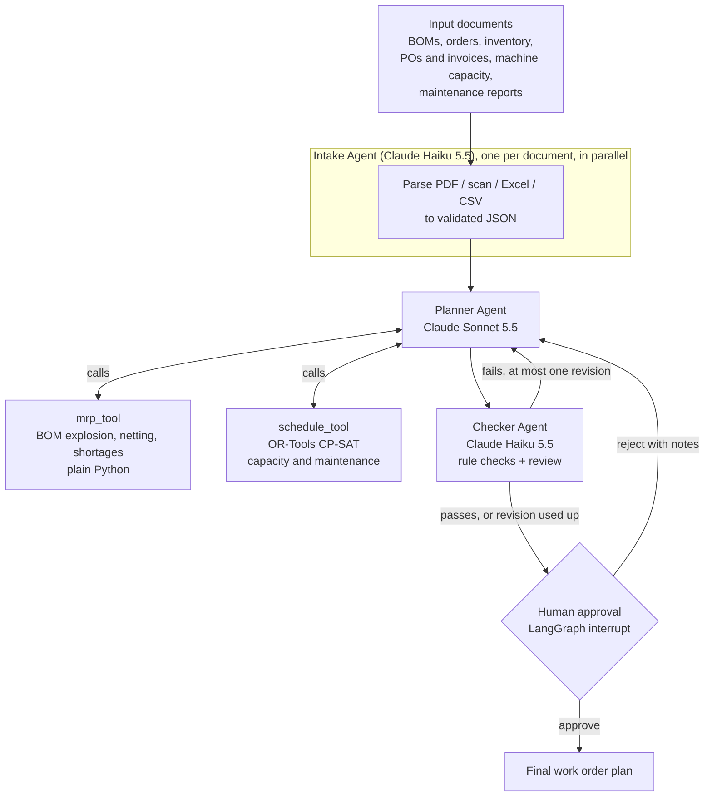

# Workflow

Work Order Planner runs as a fixed LangGraph workflow with explicit edges and one review loop. The order of steps never changes, so routing needs no extra LLM calls.

## Steps

1. **Intake (Claude Haiku 5.5).** LangGraph `Send` fans out one Intake call per document. Excel and CSV files are loaded with pandas; PDFs and scans are read by the model. Outputs are checked against Pydantic schemas, with one repair retry.
2. **Planner (Claude Sonnet 5.5).** Calls `mrp_tool` to compute material requirements, stock netting against open POs, and shortages, then `schedule_tool` to build a feasible schedule around machine capacity and planned maintenance. It decides order priority, splits or expedites, and substitutes, and writes the plan's rationale.
3. **Checker (Claude Haiku 5.5).** Runs code-based rule checks (PO and invoice mismatches, due-date risk, missing certificates, capacity conflicts), explains them, and sends the plan back to the Planner once if it fails.
4. **Human approval.** A LangGraph `interrupt()` with a checkpointer pauses the run until a person approves or rejects the plan.

Every run logs each agent call with its tokens and latency, so the hand-offs between agents can be shown as execution traces.
